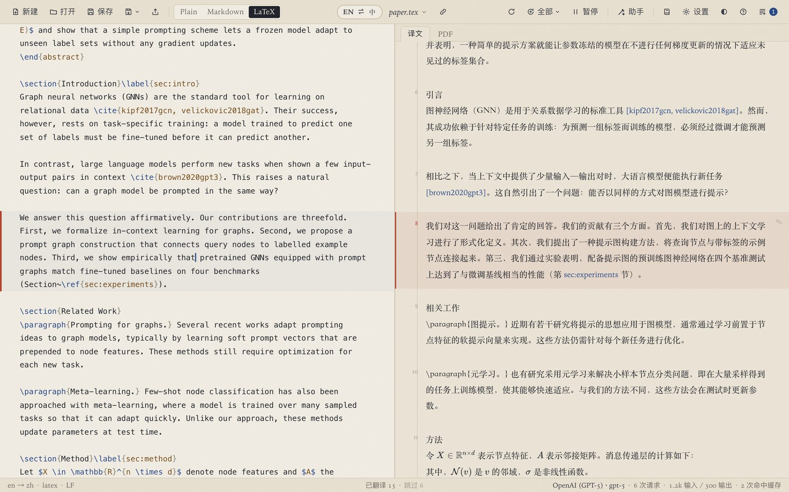
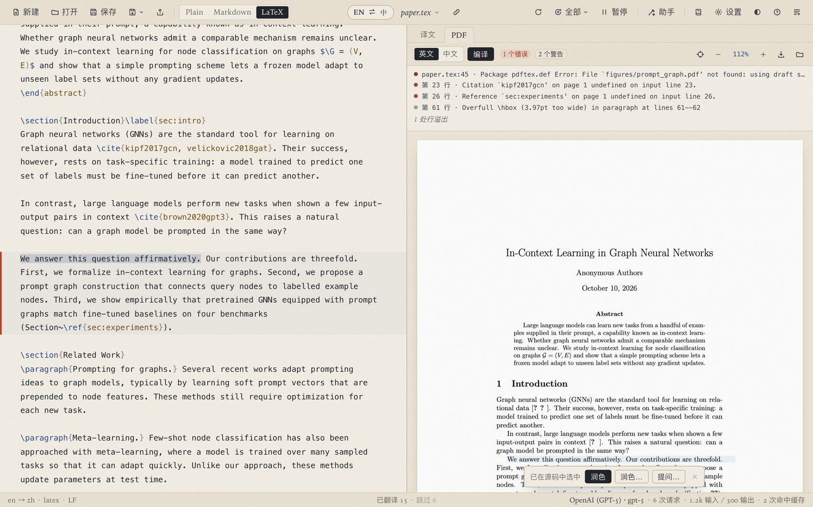
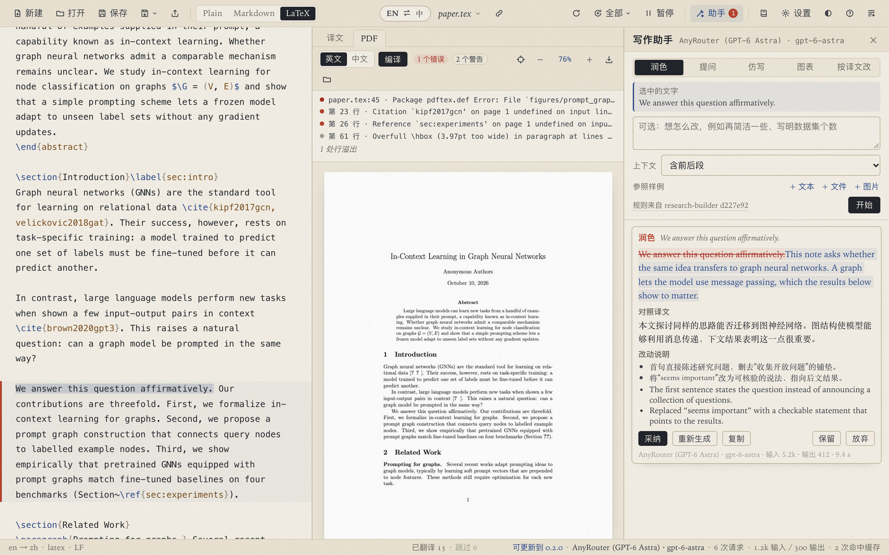
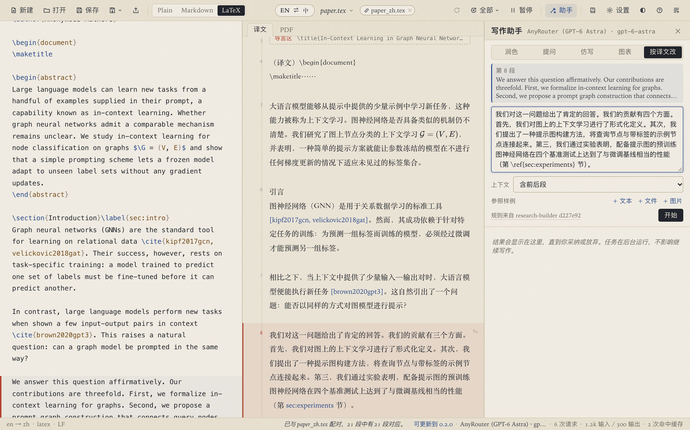
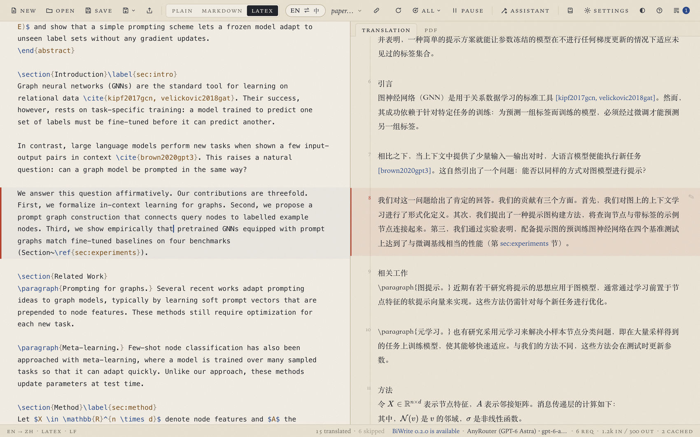
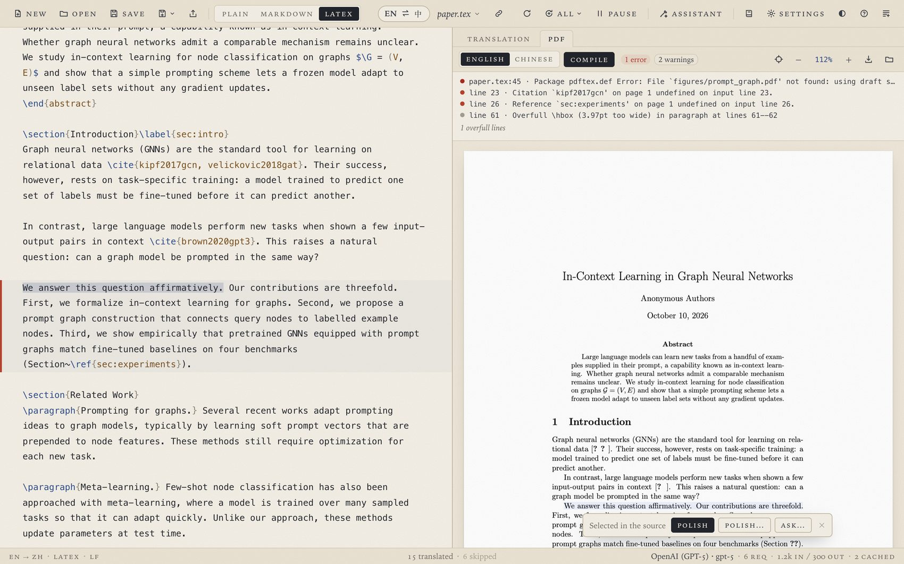
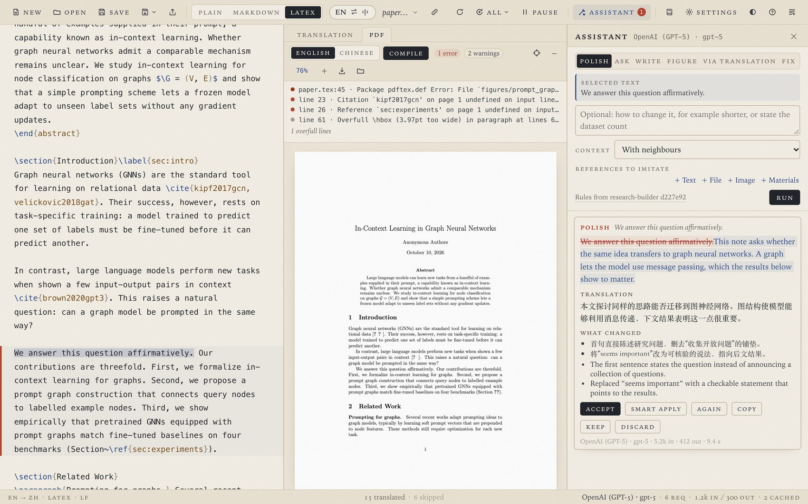
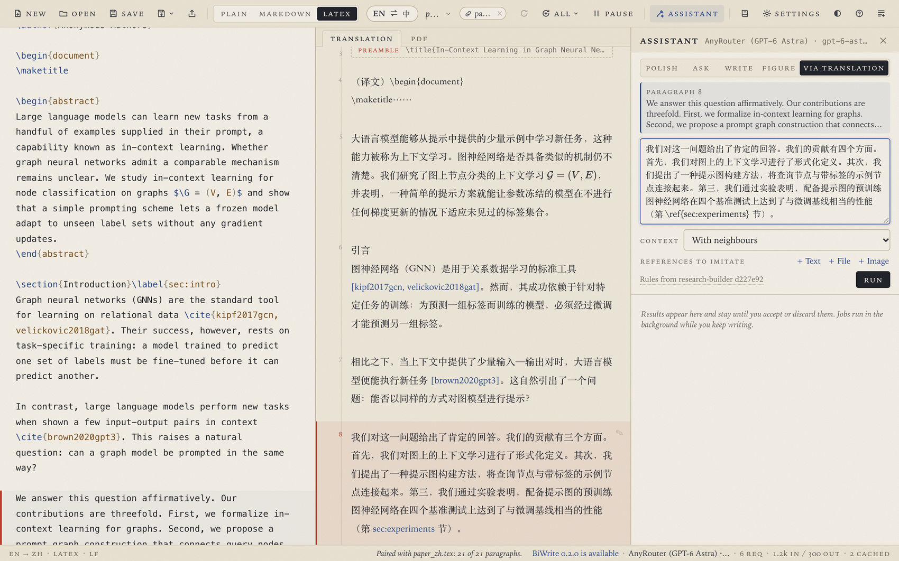

<div align="center">

# BiWrite

**Write an academic paper in English and Chinese at once**<br>
**中英双语论文写作桌面编辑器**

[](https://linux.do/) [](https://github.com/qzkinhit/research-builder) [](https://github.com/zzccppp/biwrite/releases)

**Friend link · 友情链接** [LINUX DO](https://linux.do/), the community where BiWrite is discussed · BiWrite 交流讨论的社区

[Download · 下载](https://github.com/zzccppp/biwrite/releases) · [User guide (PDF)](docs/manual/BiWrite-Manual-en.pdf) · [使用说明（PDF）](docs/manual/BiWrite-Manual-zh.pdf)

</div>

> [!TIP]
> **BiWrite is the desktop editor of [research-builder](https://github.com/qzkinhit/research-builder).** research-builder is an open-source (MIT) skill for Claude Code and Codex that carries an empirical paper through five stages, from aligning on the idea to a bilingual LaTeX paper whose numbers come from the experiment records. BiWrite applies its rules while you write by hand. Polishing and edits follow its rules on AI-style phrasing and voice matching, new paragraphs follow its paper anatomy, figures follow its figure style, and PowerPoint figures follow its rules for editable diagrams with its icons. Run the research with the skill in a terminal and write the paper in BiWrite, with one set of rules in both. BiWrite ships a copy of the skill, updates it from GitHub in Settings, and can use your own skill folder together with its `materials/` (your papers, figures and icons).
>
> **BiWrite 是 [research-builder](https://github.com/qzkinhit/research-builder) 的桌面编辑器。** research-builder 是开源（MIT）的科研 skill，供 Claude Code 与 Codex 使用，按五个阶段推进实证型论文，从对齐想法一直到数字由实验记录回填的中英文 LaTeX 稿件。BiWrite 在你动手写作时执行它的规则。润色与修改遵循它的去 AI 腔规则和声音匹配，仿写遵循它的论文骨架，图表遵循它的图表风格，PPT 图遵循它的可编辑插图规则并使用它的图标。在终端里用 skill 推进研究，在 BiWrite 里写论文，两边用同一套规则。BiWrite 自带一份 skill，可以在设置中从 GitHub 更新，也可以换成你自己的 skill 文件夹，连同其中的 `materials/`（你的论文、图和图标）一起使用。

<details>
<summary><b>简体中文</b></summary>

<br>

BiWrite 是一个中英双语的论文写作桌面编辑器。左侧编写正文（LaTeX、Markdown 或纯文本），右侧逐段显示另一种语言，只有改动过的段落会重新翻译。LaTeX 论文在源码旁边编译成 PDF，未保存的修改也能编译，点击 PDF 中的句子即可在源码中选中该句。写作助手按 research-builder 的规则润色、修改、回答问题、仿写新段落、生成图表和修复 LaTeX 错误。界面可选英文或中文。

图文说明书先按一篇论文从模板到投稿的顺序介绍完整写作流程，再逐步介绍每项功能：[使用说明（PDF）](docs/manual/BiWrite-Manual-zh.pdf)。软件工具栏的「说明书」按钮会在 GitHub 上打开它。



## 目录

* [功能一览](#功能一览)
* [安装](#安装)
* [配置模型接口](#配置模型接口)
* [双语编辑](#双语编辑)
* [LaTeX 论文](#latex-论文)
* [已有的中文版](#已有的中文版)
* [写作助手](#写作助手)
* [我的素材](#我的素材)
* [号池与第三方接口](#号池与第三方接口)
* [请求日志](#请求日志)
* [版本更新](#版本更新)
* [术语表、缓存与日志](#术语表缓存与日志)
* [开发](#开发)

## 功能一览

| 功能 | 说明 |
|---|---|
| [双语编辑](#双语编辑) | 左侧英文，右侧中文（用「EN ⇄ 中」可以反过来）。只有改动过的段落会重新翻译，并以原译文为基础修订。公式、引用、交叉引用、标签、网址和注释以占位符发给模型，返回后逐字节还原。中文文件打开后以中文为原文，未译完就切换时，剩余段落译好后自动填回。 |
| [LaTeX](#latex-论文) | 用本机的 TeX 发行版编译（latexmk、pdfLaTeX、XeLaTeX 或 LuaLaTeX，按项目的 `latexmkrc` 或宏包选择）。未保存的修改在缓存文件夹中编译，本地文件保持上次保存的内容。PDF 显示在右侧，点击 PDF 在源码中选中句子，`⌘⌥J` 在 PDF 中定位光标，问题列表跳到对应行。也可以由译文编译中文 PDF。 |
| [你自己的中文版](#已有的中文版) | `paper.tex` 与 `paper_zh.tex`，或 `sections_en/` 与 `sections_zh/`，逐段配对。你的中文直接作为译文，不产生请求，保存时把每个改动过的段落原位写入另一个文件。 |
| [写作助手](#写作助手) | 润色（写上要求就按要求修改）、提问、仿写新段落、生成图表（LaTeX 代码、PDF 图或可编辑的 PPT 图，可以临摹一张图或仿照它的风格）、语法修复，或改写某段译文让原文随之修改。任务在后台运行，由你决定是否采纳，LaTeX 论文中采纳会先由模型调整、编译检查再写入。 |
| [我的素材](#我的素材) | 与 research-builder 的 `materials/` 相同的文件夹。你的论文给出仿写的文风，你的图和论文可以作为参照样例，你的图标用在 PPT 图里。 |
| [模板](#模板) | 内置 VLDB（PVLDB 2027）、ICLR 2027 和 IEEE TII。可以把项目文件夹或 `.zip` 导入为模板，把项目导出为模板，打开任意 LaTeX 文件夹。 |
| [模型接口](#配置模型接口) | OpenAI 兼容的 Chat Completions（OpenAI、DeepSeek、通义千问、Kimi、OpenRouter、Ollama 等本地服务）、OpenAI Responses 接口和 Anthropic Messages 接口，附带预设，也可以配置第三方服务。翻译和写作助手可以用不同的接口。 |
| [号池](#号池与第三方接口) | 每个接口可以挂多个命名的密钥，按每个密钥的并发上限均匀使用，限流时换号，可以原位换上新密钥，可以导入和导出到文件。 |
| [请求日志](#请求日志) | 记录每次请求发出的模型、推理强度和服务等级，以及服务端声明的实际值，还有耗时、token 和所用密钥。 |
| [版本更新](#版本更新) | 软件内可以安装 GitHub 上发布的任意版本，包括预发布的分支构建和旧版本。 |
| [窗口](#安装) | 关闭窗口后 BiWrite 带着打开的文档留在菜单栏或任务栏通知区域，可以在设置中关闭这一行为。 |

## 安装

从 [Releases](https://github.com/zzccppp/biwrite/releases) 页面下载安装包：`BiWrite_<版本>_x64-setup.exe`（Windows 10/11）或 `BiWrite_<版本>_universal.dmg`（macOS 12 或更高，支持 Apple 芯片和 Intel）。安装包还没有受信任的证书签名，第一次打开需要你确认：

* **macOS**：先打开一次 BiWrite，关闭警告。然后打开「系统设置」→「隐私与安全性」，在页面下方的「安全性」一栏，macOS 会提示 BiWrite 已被阻止。点「仍要打开」，确认并输入密码。也可以在终端执行 `xattr -dr com.apple.quarantine /Applications/BiWrite.app`，效果相同。
* **Windows**：SmartScreen 提示「Windows 已保护你的电脑」时，点「更多信息」，再点「仍要运行」。

关闭窗口后，BiWrite 继续在菜单栏（macOS）或任务栏通知区域（Windows）运行，点图标可以重新显示窗口或退出。在「设置」的「窗口」一节可以关闭这一行为。

LaTeX 功能需要 TeX 发行版：macOS 用 MacTeX，Windows 和 Linux 用 TeX Live 或 MiKTeX。BiWrite 会在常见位置自动查找，装在别处时可以在「设置」的「LaTeX」一节指定文件夹。PPT 图转换成 PDF 需要 [LibreOffice](https://www.libreoffice.org/)，没有安装时只生成 PPT 文件。

## 配置模型接口

1. 打开**设置**（`⌘,`），选择「+ 添加接口…」，再选一个预设。
2. 核对 Base URL 和模型。保存密钥后，「列出模型」可以获取可用模型。
3. 粘贴一个或多个密钥（每行一个，或者一行名称、下一行密钥），点「添加接口」。密钥保存在系统钥匙串中，之后不再显示。
4. 「测试」翻译一句话。单选按钮选中的接口负责翻译。「写作助手」一节选择润色和提问所用的接口，可以让快速模型负责翻译，更强的模型负责写作。
5. 「请求节奏」中，「每次请求的段落数」（1 到 8）把多个新段落合并成一次请求，「并行请求数」可以跟随号池（密钥数 × 每个密钥的并发）或手动设置。
6. 「界面语言」在英文和中文之间切换界面。

## 双语编辑

* 用**打开**（`⌘O`）选择 `.tex`、`.md` 或 `.txt` 文件。右侧每个方块对应源文的一个段落、标题或图注，点击方块，光标跳到对应段落，该段在两侧同时高亮。
* 停止输入 0.8 秒后，改动过的段落会重新翻译，以原译文为基础修订，并以流式方式显示。公式、引用、交叉引用、标签、网址和注释以占位符发给模型，返回后按原样还原。
* 「EN ⇄ 中」把中文放到左侧编辑，右侧显示英文。只有你改过的中文段落会生成新的英文，切回英文时其余段落逐字还原。切换会等待正在翻译的段落，再点一次立即切换。这些段落先保留原文，译好后自动替换到左侧。
* **全部**菜单提供「重新翻译所有段落」「继续翻译剩余段落」（翻译失败的段落、暂停时积压的段落，以及提前切换后仍是原文语言的段落）和「把原文当作中文」（或英文）。
* 中文文件打开后以中文为原文，翻译成英文，PDF 和导出的 `.tex` 都按文件本身的语言处理。中英混合的文档判断错了，可以在**全部**菜单中改正，左侧文字明显是另一种语言时，点「EN ⇄ 中」也会直接改正。
* **保存**（`⌘S`）把文件本身的语言写回文件，编辑另一种语言时由译文组成。**另存为**（`⌘⇧S`）默认建议一个不重名的文件名，例如 `paper-2.tex`，原文件保持不变。软件内的修改，包括写作助手的采纳和还原，都只作用于编辑器里的内容，只有保存或另存为才写入本地文件。本地文件在编辑期间被别处改过时，保存会先询问，提示里的「查看差异」逐行显示两边的不同，只供查看。

## LaTeX 论文



* 用**打开**选 `.tex` 文件，或者**新建**后选「打开 LaTeX 文件夹…」按主文件打开项目。多文件项目在标题栏列出文件，主文件通过 `\input` 和 `\include` 链、`% !TEX root = …` 注释，以及并列的 `sections_en/` 与 `sections_zh/` 文件夹确定。
* 编辑器里 `\input`、`\include` 引入的项目文件，文件名后有一个 ↗，点它或按住 ⌘ 点文件名即打开那个文件。打开某一节时，标题栏多一个「主文件」按钮，点击回到主文件。
* 多文件项目的译文页签右上角可以在「本文件」和「全文」之间切换。「全文」按主文件的引入顺序显示整篇论文，嵌套几层都可以。其他文件的段落用配对的中文文件或缓存中的译文，没有译文的段落以浅色原文显示，查看不会发出翻译请求。点其中一段，左侧打开那个文件并选中这一段。
* **PDF** 页签用 `⌘B` 编译，每次保存后也会编译（设置中的「保存 .tex 文件后自动编译」）。错误和警告显示在 PDF 上方，点击跳到对应行。文档有错误时也会生成 PDF。列表右上角的「收起」把它收起，点编译结果可以再展开。「复制日志」把全部问题和编译输出复制到剪贴板。
* **下载文中引用的图片**：文中引用的图片还不在磁盘上、而文中写了它的网址（注释里的下载命令、链接或宏参数里，网址以这个文件名结尾）时，PDF 上方会列出这些图片，点「下载到论文文件夹」即下载并重新编译。只下载图片和 PDF，只存进论文文件夹，不覆盖已有文件。
* **不保存也能编译**：`⌘B` 编译编辑器里现在的内容。未保存的修改写到论文旁边的 `.biwrite/` 缓存文件夹中编译，本地的 `.tex` 文件保持上次保存的内容，直到你点保存。写作助手生成的图片文件也先放在这里，保存时才写到论文的图片文件夹。
* **点击 PDF 中的句子**：该句的源码被选中，位于其他文件时 BiWrite 会打开那个文件。旁边的小菜单提供「润色」「润色…」和「提问…」，「润色…」打开写作助手先写要求。
* `⌘⌥J`（Ctrl+Alt+J）在 PDF 中高亮光标所在段落。右侧显示译文时，则在译文中标出光标所在的句子。点译文中的某一句，左侧选中原文中对应的那一句。
* **英文和中文 PDF**：「中文」开关用 XeLaTeX 和 `ctex` 由译文编译中文 PDF（尚未翻译的段落保持英文）。「另存 PDF…」和「导出中文 .tex…」保存副本。
* **多文件项目的中文 PDF**：打开哪个文件都编译整篇论文的中文。项目有自己的中文主文件（例如 `main_zh.tex`，或用「导入译文」与英文主文件配对过的文件），并且它引入了这一节或这一节的中文文件时，直接编译它。其余情况下，其余各节优先用与它配对的中文文件，其次用缓存中已有的译文，不为此发出新的翻译请求。点击中文 PDF 会打开对应的英文章节并选中那一段。

### 模板

**新建**列出内置模板（官方 PVLDB 和 ICLR 2027 文件、附简短骨架的 IEEE TII 类文件）和你自己的模板。「用此模板新建…」把模板复制到你命名的文件夹并打开。「导入文件夹…」和「导入 .zip…」添加自己的模板，「导出当前项目…」把当前项目连同模板描述打包成 zip。

## 已有的中文版

如果你手动维护一份中文版，BiWrite 可以直接使用它，不再翻译：

* 打开 `paper.tex` 时，如果段落能对上，会自动与 `paper_zh.tex`（也支持 `.zh`、`-zh`、`_cn`）配对，`sections_en/x.tex` 会与 `sections_zh/x.tex` 配对。标题栏的「导入译文」可以与你选择的任意文件配对。
* 段落按类型、共同的引用键与交叉引用键、标签、公式、数字和专有名词，以及长度配对，图在中文文件中位置不同也能找到对应。标题栏显示对上的段落数。
* 你的中文直接作为译文，不产生请求。改一段英文，只有这一段的中文会重新修订。保存时写入两个文件，每个改动过的段落原位替换，中文文件的其余部分逐字节不变。
* 「EN ⇄ 中」切换为编辑中文文件，英文以同样方式跟随。
* 「另存为」把两个文件都按新名字另存（`paper-2.tex` 和 `paper_zh-2.tex`），原文件保持不变。

## 写作助手



用**助手**（`⌘J`）打开。它作用于选中的文字，没有选中时作用于光标所在段落。文档没有保存时，助手直接处理编辑器里现在的内容。

* **润色**（`⌘⇧P` 润色光标所在段落）按写作规则修改，去除 AI 腔和拼接句子的破折号、分号，保持论断、数字、引用和公式不变。在输入框写上要求时按要求修改，写出的文字同样遵守写作规则。
* **提问**就所选文字或整篇论文回答问题（可以追问），只给出回答，不改动正文。
* **仿写**按你的要求在光标所在段落之后写新段落，新段落模仿参照样例的写法，不照搬它的句子、结论、数字和引用，并附带对照中文。
* **图表**生成插入到段落之后的图或表。LaTeX 论文可以在「格式」中选择生成什么：
  * 「LaTeX 代码」在采纳时插入，代码还需要的宏包同时补进导言区。
  * 「PDF 图」用 TikZ 画好后单独编译成 PDF，用 `\includegraphics` 引入，编译出错时先让模型修好。
  * 「PPT 图」生成可编辑的 PowerPoint 示意图，由原生形状、块状箭头和 SVG 图标组成，遵循 skill 的插图规则。装了 LibreOffice 时同时转换成论文引用的 PDF。

  生成的文件在保存时写到论文其他图片所在的文件夹，结果卡片上的「另存为」可以另存 PDF、PPT 或 PNG。
* **参照图片**：做图表时，「参照样例」中的每张图片可以选「临摹」或「仿风格」。「临摹」把图片当作本文这张图的草稿，照着重画，并按正文核对其中的文字、符号、公式和步骤，改正不一致之处并在改动说明中逐条列出（「上下文」选「全文」时按整篇论文核对）。「仿风格」把图片当作其他论文的图，只学它的版式、配色、线条和箭头，内容来自你的正文和要求。
* **语法修复**编译文档，把 TeX 报告的错误连同所在行交给模型，给出能让文档编译通过的改动，最多三轮。改动以差异显示，由你决定是否采纳。
* **按译文改**在输入框中预填这一段的中文。改写中文后运行，英文以最小改动修订为相同的意思。每个已翻译段落上的铅笔按钮可以直接进入这个操作。
* 「上下文」可选只发送目标段落、含前后段或整篇论文。「参照样例」可以添加文字、文件（`.tex`、`.md`、`.txt`）、图片，或者用「+ 素材」从[素材文件夹](#我的素材)中选论文和图。

每个任务都在后台运行。结果以差异显示改动，附修订稿的中文和中英文两份改动说明。「采纳」把结果写入文字当前所在的位置，即使你在等待期间继续输入。LaTeX 论文中采纳会先让模型把结果改成适合这篇文档的样子（改用文档已有的宏包和颜色，补上需要的导言区行），再放进文档编译一次，如果带来新的错误（缺宏包、缺 TikZ 库、模板颜色等），先让模型修好再写入，修不好或模型、编译不可用时按原样写入。如果目标文字本身在等待期间被改过，「让模型重新套用」会把修订套用到当前文本上。「还原」撤回已采纳的结果。还原插入的图表时，导言区补加的行由模型判断是否还有用，模型选出的行删掉后先编译一次，没有新的错误才真正删除。模型无法连接时只撤掉正文，导言区不动。一张卡片在采纳或还原时，其他卡片要等它结束，编辑器也暂不接受输入。「设置」中的「采纳和还原由模型辅助」默认勾选，不勾时采纳直接写入，还原只撤掉正文。

多文件项目中，每张卡片属于提出它的那个文件和那种语言。切到别的文件或在中英之间切换后，卡片注明它属于哪个文件，点「切换过去」回到那里再采纳。离开期间那段文字被改动、找不到原来的位置时，卡片会说明，不能采纳。采纳或还原进行期间，切换文件和切换语言都要等它结束。上下文选「全文」时，模型读到的是按主文件拼起来的整篇论文，正在编辑的文件用编辑器里的内容。语法修复只修改当前文件，项目其他文件中的错误另外列出，点文件名打开它再修。

规则来自 [research-builder](https://github.com/qzkinhit/research-builder)，每项操作使用 skill 中对应的部分：润色和修改用去 AI 腔规则与写作手册，仿写还用论文骨架和讲故事的套路，图表用图表风格，PPT 图用 `paper-figure-pptx` 的插图规则与图标库。BiWrite 自带一份 skill，「设置」中的「写作技能」可以从 GitHub 更新，也可以换成你自己的 skill 文件夹。



## 我的素材

公开的 skill 不带作者自己的论文、图和图标，所以 BiWrite 有一个素材文件夹，分类与 research-builder 的 `materials/` 相同，把文件放进对应的文件夹即可。使用你自己的 skill 文件夹时，素材文件夹就是其中的 `materials/`，否则在 BiWrite 的数据目录里，更新或更换 skill 都不受影响。「设置」中的「我的素材」显示它的位置和各文件夹的文件数，「打开素材文件夹」在访达或资源管理器中打开它。

| 文件夹 | 放什么 | BiWrite 怎样用 |
|---|---|---|
| `writing-samples/` | 最能代表你文风的中英文段落或全文（`.tex`、Word、`.md`、`.txt`） | 润色、修改、按译文改和仿写时，取前三篇的开头作为文风样本 |
| `domain/` | 你的论文，LaTeX 源（每篇一个文件夹）、Word、PDF、`.md` 或 `.txt` | 「+ 素材」中的参照样例，多文件的 LaTeX 论文按主文件拼合 |
| `general/` | 基金本子、项目申请书、技术报告 | 同上 |
| `figures/` | 你满意的图，PNG、JPEG、SVG、PDF 或 PPTX | 「+ 素材」中的参照图片，用于临摹或仿风格，PPTX 需要 LibreOffice |
| `icons/` | SVG 图标，或含 SVG 图标的 PPTX | PPT 图的图标。SVG 以文件名作为含义，PPTX 中的图标取图片的替代文字，没有替代文字的不使用 |
| `ppt/` | 学术报告与海报 | 不使用 |

## 号池与第三方接口

BiWrite 支持 OpenAI 兼容的 Chat Completions 接口、OpenAI Responses 接口和 Anthropic Messages 接口。第三方服务的配置方式与其他接口相同，预设会填好接口地址、模型、推理强度、服务等级、每个密钥的并发和重试次数。

「管理号池…」显示号池：

* 给每个密钥起名字。请求交给最空闲的可用密钥，所以各个密钥被均匀使用。
* 被限流的密钥进入冷却，请求转到其他密钥。被拒绝的密钥暂停使用。
* 「每个密钥的并发」限制单个密钥的并发数，「并行请求数」可以跟随号池。
* 「换 key」把某个密钥原位换成你粘贴的新密钥，名称和位置不变，例如替换一直没有得到应答的密钥。
* 「忽略」让某个密钥暂时不参与任何请求，「取消忽略」后恢复使用，并行请求数按其余密钥计算。
* 「导出到文件…」把名称和密钥保存为文本文件，便于迁移或分享，「从文件导入…」读回这种文件。密钥直接写入文件，不经过界面。文件中是明文密钥，只分享给你信任的人。

## 请求日志

**日志**（`⌘⇧L`）列出每次请求发出的模型、推理强度和服务等级，以及服务端声明的实际值（不一致时标出），还有 HTTP 状态、首字延迟、总耗时、token（含缓存和推理 token）、所用密钥（只显示名称和末尾几位）以及重试和换号的说明，还有发给接口的系统提示、发送内容和收到的回复。日志可以暂停、清空和保存到文件，只存在本机，不记录密钥。

## 版本更新

「设置」中的「版本更新」列出 GitHub 上的全部发布版本及更新说明。选择任意版本（包括由分支构建的预发布版本）后点「安装」。安装包下载后按 GitHub 提供的 SHA-256 校验。macOS 上原地替换应用，点「立即重启」进入新版本。Windows 上安装程序在 BiWrite 退出后运行。BiWrite 启动时会检查新版本并在状态栏提示（可以关闭）。

## 术语表、缓存与日志

**术语表**保存你对术语的中文译法，或用「保留英文」让术语保持英文。可以导入两列 `term,translation` 的 CSV（UTF-8，Excel 中选「CSV UTF-8」，译法为空或写 `KEEP` 表示保留英文）。只有提到改动过的术语的段落会重新翻译。

翻译缓存位于 `~/Library/Application Support/app.biwrite.desktop/cache.sqlite3`，「设置」中的「翻译缓存」一节显示其内容并可清空。日志写在 `~/Library/Logs/app.biwrite.desktop/`（Windows 为 `%LOCALAPPDATA%\app.biwrite.desktop\logs\`），每天最多 5 MB，保留 7 天。

## 开发

需要 Rust 1.85 或更高版本、Node 20 或更高版本、npm，macOS 上还需要 Xcode 命令行工具。

```sh
npm install
npm run app                     # tauri dev，启动 Vite 开发服务器和应用窗口
npm run dev:mock                # 在浏览器中用模拟后端运行界面
npx tauri build --debug --no-bundle
./target/debug/biwrite samples/paper.tex
```

`dev/mock.html?latex` 打开示例论文及其 PDF（需先把 `samples/paper.tex` 编译为 `dev/sample.pdf`）。

检查：

```sh
cargo test --workspace
cargo clippy --workspace --all-targets -- -D warnings
npm run check                   # svelte-check，有警告即失败
npm test                        # 前端单元测试
cargo test -p biwrite-latex --test tex -- --ignored   # 用本机 TeX 编译测试
cargo test -p biwrite --lib -- --ignored workflow      # 用每个模板走完全部写作步骤，需要本机 TeX
```

代码分为不依赖 Tauri 的几个 crate（`biwrite-core` 负责分段、占位符、配对和助手提示词，`biwrite-engine` 负责翻译队列和缓存，`biwrite-providers` 负责模型接口和号池，`biwrite-latex` 负责编译、SyncTeX 和模板），以及 `src-tauri/` 中的应用和 `src/` 中的 Svelte 前端。详见 [ARCHITECTURE.md](ARCHITECTURE.md)。

### 发布

`.github/workflows/build-installers.yml` 在每次推送 `master` 时构建两个安装包（作为工作流产物）。发布新版本时，同步修改 `src-tauri/tauri.conf.json`、`package.json` 和根目录 `Cargo.toml` 中的版本号，提交后推送对应的标签：

```sh
git tag -a v0.2.0 -m "BiWrite 0.2.0"
git push origin v0.2.0
```

工作流会检查标签与版本号一致，构建两个安装包并创建附带安装包的 GitHub Release。带后缀的标签（`v0.2.1-beta.1`）发布为预发布版本，软件的「版本更新」中同样会列出。

</details>

<details open>
<summary><b>English</b></summary>

<br>

A desktop editor for writing an academic paper in English and Chinese at
once. You write on the left (LaTeX, Markdown or plain text). The right pane
shows the other language, one block per paragraph, and only the paragraphs
you change are translated again. A LaTeX paper compiles into a PDF beside
the source, unsaved edits included, and a click on a sentence in the PDF
selects it in the source. A writing assistant polishes, edits, answers
questions, writes new paragraphs, writes figures and repairs LaTeX errors
with the rules of research-builder. The interface is in English or Chinese.

The illustrated user guide follows one paper from a template to submission and
then covers every feature step by step:
[User guide (PDF)](docs/manual/BiWrite-Manual-en.pdf). The **Guide** button in
the toolbar opens it on GitHub.



## Contents

* [What it does](#what-it-does)
* [Install](#install)
* [Set up a model provider](#set-up-a-model-provider)
* [Bilingual editing](#bilingual-editing)
* [LaTeX papers](#latex-papers)
* [An existing Chinese version](#an-existing-chinese-version)
* [Writing assistant](#writing-assistant)
* [My materials](#my-materials)
* [Key pools and third-party APIs](#key-pools-and-third-party-apis)
* [Request log](#request-log)
* [Updates](#updates)
* [Glossary, cache and logs](#glossary-cache-and-logs)
* [Development](#development)

## What it does

| Area | What you get |
|---|---|
| [Bilingual editing](#bilingual-editing) | English on the left, Chinese on the right (or the other way round with `EN ⇄ 中`). Only edited paragraphs are translated again, revised from their previous translation. Math, citations, references, labels, URLs and comments reach the model as placeholders and come back byte for byte. A Chinese file opens as the Chinese side, and swapping before everything is translated fills in the rest as it arrives. |
| [LaTeX](#latex-papers) | Compiles with your TeX distribution (latexmk, pdfLaTeX, XeLaTeX or LuaLaTeX, as the project's `latexmkrc` or packages ask). Unsaved edits compile in a cache folder, and the file on disk stays as last saved. The PDF shows in the right pane, a click in the PDF selects the sentence in the source, `⌘⌥J` shows the cursor's place in the PDF, and problems link to their lines. A Chinese PDF is built from the translation. |
| [Your own Chinese version](#an-existing-chinese-version) | `paper.tex` with `paper_zh.tex`, or `sections_en/` with `sections_zh/`, pair up paragraph by paragraph. Your Chinese becomes the translation with no requests, and saving writes each edited paragraph into the other file in place. |
| [Writing assistant](#writing-assistant) | Polish (as you ask, when you write a request), ask, write new paragraphs in the manner of a reference, write figures or tables (LaTeX code, a PDF picture or an editable PowerPoint diagram, traced from an image or in the style of one), fix LaTeX errors, or rewrite a paragraph's translation and let the paragraph follow. Jobs run in the background, you decide what is applied, and in a LaTeX paper *Accept* has the model fit the result and compiles before it applies. |
| [My materials](#my-materials) | The folders of research-builder's `materials/`. Your papers give the voice to write in, your figures and papers serve as references, and your icons go into PowerPoint figures. |
| [Templates](#templates) | VLDB (PVLDB 2027), ICLR 2027 and IEEE TII built in. Import a project folder or a `.zip` as a template, export a project as one, open any LaTeX folder. |
| [Model providers](#set-up-a-model-provider) | OpenAI-compatible Chat Completions (OpenAI, DeepSeek, Qwen, Kimi, OpenRouter, local servers such as Ollama), the OpenAI Responses API and the Anthropic Messages API, with presets, third-party services included. Translation and the assistant can use different providers. |
| [Key pools](#key-pools-and-third-party-apis) | Many named keys per provider, used evenly with a per-key limit, failover on rate limits, a new key in place of an old one, import and export to a file. |
| [Request log](#request-log) | Every model request with the model, reasoning effort and service tier that were sent and the ones the server declared, timings, tokens and the key used. |
| [Updates](#updates) | Any GitHub release can be installed from inside the app, pre-releases (branch builds) and older versions included. |
| [Window](#install) | Closing the window keeps BiWrite in the menu bar or notification area with the document open. Settings turns this off. |

## Install

Download the installer from the
[Releases](https://github.com/zzccppp/biwrite/releases) page:
`BiWrite_<version>_x64-setup.exe` (Windows 10/11) or
`BiWrite_<version>_universal.dmg` (macOS 12 or later, Apple Silicon and
Intel). The installers are not signed with a trusted certificate yet, so the
first launch needs your approval:

* **macOS.** Open BiWrite once and close the warning. Then open *System
  Settings*, *Privacy & Security*. Near the bottom, under *Security*, macOS
  shows that BiWrite was blocked. Click *Open Anyway*, confirm, and enter
  your password. In Terminal, `xattr -dr com.apple.quarantine
  /Applications/BiWrite.app` does the same.
* **Windows.** When SmartScreen shows *Windows protected your PC*, click
  *More info*, then *Run anyway*.

Closing the window keeps BiWrite running in the menu bar (macOS) or the
notification area (Windows), where its icon shows the window again or quits.
Settings, *Window*, turns this off.

LaTeX support needs a TeX distribution: MacTeX on macOS, TeX Live or MiKTeX
on Windows and Linux. BiWrite finds it in the usual places. One installed
elsewhere can be chosen in Settings, under *LaTeX*. Turning a PowerPoint
figure into a PDF needs [LibreOffice](https://www.libreoffice.org/). Without
it the PowerPoint file alone is made.

## Set up a model provider

1. Open **Settings** (`⌘,`), choose *Add provider…* and pick a preset.
2. Check the base URL and model. *List models* fetches the models once a key
   is saved.
3. Paste one key, or several (one per line, or a name on one line and its key
   on the next), and click *Add provider*. Keys go into the system keychain
   and are never shown again.
4. *Test* translates one sentence. The radio button makes the provider the
   one that translates. *Writing assistant* chooses the provider for
   polishing and questions, so a fast model can translate while a stronger
   one writes.
5. Under *Requests*, *Paragraphs per request* (1 to 8) puts several new
   paragraphs into one request, and *Parallel requests* follows the key pool
   (keys × requests per key) or a number you set.
6. *Language* switches the interface between English and Chinese.

## Bilingual editing

* **Open** (`⌘O`) a `.tex`, `.md` or `.txt` file. Each block on the right is
  one paragraph, heading or caption of the source. A click on a block moves
  the cursor to its paragraph and highlights it on both sides.
* 0.8 seconds after you stop typing, the paragraphs you changed are
  translated again, revised from their previous translation and streamed as
  they arrive. Math, citations, references, labels, URLs and comments reach
  the model as placeholders and come back exactly as they were.
* `EN ⇄ 中` puts the Chinese on the left to edit, with the English on the
  right. Only the Chinese paragraphs you change get new English, and the
  other paragraphs keep your English word for word when you swap back. The
  swap waits for paragraphs still being translated, and a second press swaps
  at once. Those paragraphs keep their text for the moment and are filled in
  on the left as their translations arrive.
* **All** opens a menu with *Retranslate every paragraph*, *Continue with the
  rest* (failed paragraphs, paragraphs waiting while translation is paused,
  and paragraphs still in the other language after an early swap) and *Read
  the document as Chinese* (or as English).
* A Chinese file opens as the Chinese side and is translated into English.
  The PDFs and the exported `.tex` follow the file's language. A mixed
  document taken for the wrong language is set right from the **All** menu,
  or with `EN ⇄ 中` when the text plainly is the other language.
* **Save** (`⌘S`) overwrites the file with its own language, composed from
  the translations while you edit the other one. **Save As** (`⌘⇧S`)
  suggests a name not taken yet, such as `paper-2.tex`, and leaves the
  original as it was. Edits made in BiWrite, the assistant's Accept and
  Revert among them, change only what the editor shows, and only Save or
  Save As writes your files. When the file was changed elsewhere while you
  edited, saving asks first, and *Show the changes* in the notice shows the
  two versions line by line, for you to look at.

## LaTeX papers



* **Open** a `.tex` file, or **New** then *Open LaTeX folder…* to open a
  project by its main file. A multi-file project shows its files in the title
  bar, and the main file is found through `\input` and `\include` chains,
  `% !TEX root = …` comments, and sibling `sections_en/` and `sections_zh/`
  folders.
* A project file that `\input` or `\include` reads has a ↗ after its name in
  the editor. A click on it, or a ⌘-click on the name, opens that file.
* In a project of several files, the Translation tab switches between *This
  file* and *Whole paper*. The whole paper follows the main file's includes
  to any depth. Other files' paragraphs come from their paired Chinese files
  or the translations in the cache, a paragraph without one shows its own
  words in a faint colour, and looking requests nothing. A click on one opens
  its file with that paragraph selected. With a
  section open, *Main file* in the title bar goes back to the main file.
* The **PDF** tab compiles with `⌘B` and after every save (Settings,
  *Compile after saving a .tex file*). Errors and warnings appear above the
  PDF and open their line. A document with errors still gets its PDF. *Fold*
  folds the list away (click the build result to show it again), and *Copy
  log* copies every problem and the build output.
* **Download the pictures the document names.** When a picture the document
  names is not on disk yet and the document gives its web address (in a
  download command in a comment, a link or a macro's argument, ending in the
  file's name), the PDF pane lists it, and *Download into the paper's folder*
  fetches it and builds again. Only pictures and PDFs are fetched, only into
  the paper's folder, and never over a file that is there.
* **Compile without saving.** `⌘B` compiles what the editor shows. Unsaved
  edits are written to the `.biwrite/` cache folder beside the paper and
  compiled there, and the `.tex` file on disk stays as last saved until you
  save. Figure files the assistant made wait in the same folder and go to
  the paper's figure folder when you save.
* **Click a sentence in the PDF.** The source of that sentence is selected,
  in the file it comes from (BiWrite opens that file if needed), and a small
  menu offers *Polish*, *Polish…* and *Ask…* on it (*Polish…* opens the
  writing assistant to write a request first).
* `⌘⌥J` (Ctrl+Alt+J) highlights the cursor's paragraph in the PDF, or marks
  its sentence in the translation when the right pane shows the translation.
  A click on a sentence of the translation selects the same sentence of the
  source.
* **English and Chinese PDFs.** The *Chinese* switch builds the Chinese PDF
  from the translation with XeLaTeX and `ctex` (paragraphs not translated
  yet stay English). *Save PDF as…* and *Export Chinese .tex…* save copies.
* **The Chinese PDF of a project of several files** is the whole paper,
  whichever file is open. A Chinese main file of the project's own
  (`main_zh.tex`, or one paired with the main file by *Pair*) that includes
  the open section, or its Chinese file, is built as it is. Otherwise each
  other section comes from its paired Chinese file,
  else from the translations in the cache, and no translation is requested
  for it. A click in the Chinese PDF opens the English section at that
  paragraph.

### Templates

**New** lists the built-in templates (official PVLDB and ICLR
2027 files, the IEEE TII class with a short skeleton) and your own. *New
paper…* copies one into a folder you name and opens it. *Import folder…* and
*Import .zip…* add your own templates, *Export this project…* zips the open
project with a manifest.

## An existing Chinese version

If you keep a Chinese version by hand, BiWrite can use it instead of
translating:

* Opening `paper.tex` pairs it with `paper_zh.tex` (also `.zh`, `-zh`,
  `_cn`), and `sections_en/x.tex` with `sections_zh/x.tex`, when their
  paragraphs pair up. *Pair* in the title bar pairs with any file you pick.
* Paragraphs pair by kind, shared citation and reference keys, labels, math,
  numbers and names, and length, so a figure placed elsewhere in the Chinese
  file still finds its partner. The title bar shows how many paired.
* Your Chinese is the translation, with no requests. Edit an English
  paragraph and only its Chinese is revised. Saving writes both files, and
  each changed paragraph is replaced in place. The rest of the Chinese file
  stays byte for byte.
* `EN ⇄ 中` swaps to editing the Chinese file, with the English following
  the same way.
* *Save As* saves both files under the new name (`paper-2.tex` and
  `paper_zh-2.tex`) and leaves the originals as they were.

## Writing assistant



Open it with **Assistant** (`⌘J`). It works on the selection, or on the
paragraph at the cursor, as the editor shows it, saved or not:

* **Polish** (`⌘⇧P` polishes the paragraph at the cursor) applies the
  writing rules. It removes AI-style phrasing and dashes or semicolons that
  splice sentences, and keeps claims, numbers, citations and formulas.
  With a request in the box, it changes the text as asked, by the same
  rules.
* **Ask** answers a question about the text or the whole paper (with
  follow-up questions), and leaves the text as it is.
* **Write** writes new paragraphs after the paragraph at the cursor, as your
  instruction says. The new text follows the manner of the references,
  never their sentences, claims, numbers or citations, and comes with its
  Chinese.
* **Figure** writes a figure or table to insert after the paragraph. In a
  LaTeX paper, *Format* chooses what it becomes:
  * *LaTeX code* is inserted on *Accept*, and the packages it still needs
    are added to the preamble with it.
  * *PDF picture* is TikZ built into a PDF of its own and included with
    `\includegraphics`. When it does not compile, the model repairs it first.
  * *PowerPoint* is an editable diagram of native shapes, block arrows and
    SVG icons that follows the skill's figure rules. With LibreOffice
    installed, the PDF the paper includes is made from it too.

  The files go next to the paper's other figures when you save, and *Save
  as* on the result saves a copy as PDF, PowerPoint or PNG.
* **Images.** In a figure, each image under *References* is either *Trace*
  or *Style*. *Trace* takes the image as a draft of this figure, redraws it,
  checks its text, symbols, formulas and steps against the paper, corrects
  what disagrees and lists each correction in the notes (against the whole
  paper when *Context* is *Whole document*). *Style* takes the image as a
  figure of another paper and keeps only its layout, colours, lines and
  arrows, while the content comes from your text and request.
* **Fix** compiles the document, gives TeX's errors with their lines to the
  model, and offers the changes that make the document compile, in at most
  three rounds. The changes show as a diff for you to accept.
* **Via translation** fills the box with the paragraph's Chinese. Rewrite the
  Chinese, run it, and the English is revised to say the same, with as little
  change as possible. The pencil on every translated paragraph starts it.
* *Context* sends the paragraph alone, with its neighbours, or with the whole
  paper. *References* takes passages, files (`.tex`, `.md`, `.txt`), images,
  or papers and figures of the [materials folder](#my-materials) through
  *+ Materials*.

Every job runs in the background. The result shows the changes as a diff,
the Chinese of the revision and the reasons in both languages. *Accept*
applies it where the text is now, even after you kept typing. In a LaTeX
paper the model first fits the result to the document (the packages and
colours the document has, and the lines it needs before `\begin{document}`),
then the document is compiled with it, and when that brings
new errors (a missing package, a TikZ library, a colour of the template),
has the model repair them before applying, or applies it as it is when they
cannot be repaired or neither the model nor a build can be used. If the target itself
was edited meanwhile, *Re-apply with the model* brings the revision onto the
current text. *Revert* takes an applied result back. Reverting an inserted
figure also takes out the lines it added before `\begin{document}` that the
model judges no longer needed, once a build without them brings no new
error. When the model cannot be reached, only the figure goes. While one
card is accepted or reverted, the others wait for it and the editor takes
no typing. *Accept and Revert
with the model's help*, in Settings, is on by default. Off, Accept applies
the result at once and Revert takes out only the text.

In a project of several files, each card belongs to the file and the
language it was made in. With another file open, or the other language, the
card names its file, and *Switch there* goes back to accept it. A card whose
text changed meanwhile so that its place is gone says so and cannot be
accepted. While a card is accepted or reverted, opening another file or
swapping languages waits for it. With *Whole document* as the context, the
model reads the whole paper, put together from the main file, with the open
file as the editor has it. A fix changes only the open file, and lists the
errors of the project's other files apart. A click on one opens its file there.

The rules come from [research-builder](https://github.com/qzkinhit/research-builder),
each action with its part of the skill. Polishing and edits use the rules on
AI-style phrasing and the writing playbook, Write adds the paper anatomy and
the storytelling patterns, figures use the figure style, and PowerPoint
figures use the rules and icon library of `paper-figure-pptx`. BiWrite ships
a copy of the skill, Settings, *Writing skill*, updates it from GitHub, and a
folder of your own can replace it.



## My materials

The published skill holds none of the author's papers, figures or icons, so
BiWrite keeps a materials folder with the same folders as research-builder's
`materials/`. Put each file into its folder. When the skill is your own
folder, the materials folder is its `materials/`. Otherwise it lives in
BiWrite's data folder, apart from the skill, so updating or changing the
skill keeps it. Settings, *My materials*, shows where it is and what each
folder holds, and *Show folder* opens it.

| Folder | What goes there | How BiWrite uses it |
|---|---|---|
| `writing-samples/` | Passages or papers in your own voice (`.tex`, Word, `.md`, `.txt`) | The openings of the first three are samples of the voice for polishing, edits, *Via translation* and *Write* |
| `domain/` | Your papers, as LaTeX sources (a folder each), Word, PDF, `.md` or `.txt` | References under *+ Materials*. A LaTeX paper of several files is read through its main file |
| `general/` | Grant proposals and reports | The same |
| `figures/` | Figures you like, as PNG, JPEG, SVG, PDF or PPTX | Reference images under *+ Materials*, to trace or to take the style of (PPTX needs LibreOffice) |
| `icons/` | SVG icons, or PPTX files holding SVG icons | Icons of PowerPoint figures. An SVG file is named by its file name, an icon in a PPTX by the picture's alternative text, and one without alternative text is left out |
| `ppt/` | Talks and posters | Not used |

## Key pools and third-party APIs

BiWrite talks to OpenAI-compatible Chat Completions APIs, the OpenAI
Responses API and the Anthropic Messages API. A third-party service is set
up like any other provider, and its preset fills in the base URL, the model,
the reasoning effort, the service tier, the requests per key and the
retries.

*Manage keys…* shows the pool:

* Name each key. Requests go to the least busy ready key, so the keys are
  used evenly.
* A key that hits a rate limit cools down and the request moves to another
  key. A key that is rejected is set aside. A server or network error moves
  the request to one other key at most, then it is retried after a pause.
* *Requests per key* caps each key, and *Parallel requests* can follow the
  pool. When the ready keys are all busy, a request waits for one of them
  rather than going to a key that is cooling down or rejected.
* *New key* replaces a key with one you paste, under the same name and in
  the same place, for example a key that has never been answered.
* *Ignore* sets a key aside so it takes no request, and *Use again* takes it
  back. The parallel requests count the other keys only.
* Keys added or imported while paragraphs are being translated are used
  from the next request on, and requests already under way go on.
* *Export to file…* saves the names and keys to a text file to move them or
  share them, and *Import from file…* reads one back. The keys go to the file
  without passing through the window. The file holds secret keys, so share
  it only with people you trust.

## Request log

**Log** (`⌘⇧L`) lists each request with the model, reasoning effort and
service tier that were sent and the ones the server declared (differences
are marked), the HTTP status, time to first token, duration, tokens with
cached and reasoning tokens, the key used (by name and the last characters
only), notes on retries and failover, and the system prompt, the message
sent and the reply. The log can be paused, cleared and kept on disk, stays
on this computer and never holds keys.

## Updates

Settings, *Updates*, lists every release on GitHub with its notes. Pick any
version, including pre-releases built from branches, and *Install*. The
installer is downloaded and checked against the SHA-256 that GitHub reports.
On macOS the app is replaced in place and *Restart now* starts the new
version. On Windows the installer runs after BiWrite quits. BiWrite looks
for a newer release at startup and says so in the status bar (this can be
turned off).

## Glossary, cache and logs

**Glossary** holds your preferred Chinese for terms, or *Keep EN* to leave a
term in English. Import a CSV with the columns `term,translation` (UTF-8,
in Excel *CSV UTF-8*, an empty translation or `KEEP` keeps the term in
English). Only paragraphs that mention a changed term are translated again.

The translation cache lives in
`~/Library/Application Support/app.biwrite.desktop/cache.sqlite3`. Settings,
*Translation cache*, shows what it holds and can clear it. Logs are written
to `~/Library/Logs/app.biwrite.desktop/` (Windows:
`%LOCALAPPDATA%\app.biwrite.desktop\logs\`), at most 5 MB a day, kept for 7
days.

## Development

Requirements: Rust 1.85 or later, Node 20 or later, npm, and on macOS the
Xcode command-line tools.

```sh
npm install
npm run app                     # tauri dev, the Vite dev server and the app window
npm run dev:mock                # the UI in a browser with a stand-in backend
npx tauri build --debug --no-bundle
./target/debug/biwrite samples/paper.tex
```

`dev/mock.html?latex` opens the sample paper with its PDF (compile
`samples/paper.tex` into `dev/sample.pdf` first).

Checks:

```sh
cargo test --workspace
cargo clippy --workspace --all-targets -- -D warnings
npm run check                   # svelte-check, fails on warnings
npm test                        # frontend unit tests
cargo test -p biwrite-latex --test tex -- --ignored   # builds with your TeX
cargo test -p biwrite --lib -- --ignored workflow      # a paper from each template, every step, with your TeX
```

The code is split into crates without Tauri (`biwrite-core` for segments,
placeholders, pairing and the assistant's prompts, `biwrite-engine` for the
translation queue and cache, `biwrite-providers` for the model APIs and key
pools, `biwrite-latex` for builds, SyncTeX and templates) and the app in
`src-tauri/` with the Svelte frontend in `src/`. See
[ARCHITECTURE.md](ARCHITECTURE.md).

### Releasing

`.github/workflows/build-installers.yml` builds both installers on every
push to `master` (as workflow artifacts). To publish a release, set the
version in `src-tauri/tauri.conf.json`, `package.json` and the workspace
`Cargo.toml`, commit, and push a matching tag:

```sh
git tag -a v0.2.0 -m "BiWrite 0.2.0"
git push origin v0.2.0
```

The workflow checks that the tag matches the app version, builds both
installers and creates the GitHub Release with them attached. A tag with a
suffix (`v0.2.1-beta.1`) is published as a pre-release, which the app lists
under *Updates* as well.

</details>
